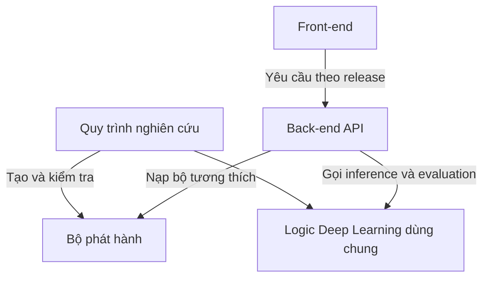

# DESIGN — COURSEWORK DEEP LEARNING

**Nhóm 4 · Topic 4 — Regression / Stock Forecasting**

**LSTM-Based Stock Price Forecasting: A Case Study on AAPL**  
**Dự báo giá cổ phiếu AAPL bằng mạng LSTM**

Tài liệu Design đi cùng bản Define của nhóm. Thiết kế sử dụng giá đóng cửa đã điều chỉnh của AAPL từ Yahoo Finance, chạy huấn luyện trên CPU và phục vụ dự báo qua hệ thống web. Tài liệu mô tả phương án triển khai và tiêu chí kiểm chứng.

| Chế độ | Đầu vào mặc định | Đầu ra | Phương pháp so sánh |
|---|---|---|---|
| Một phiên | 30 phiên giao dịch đến hết phiên t | Giá tại phiên t+1 | LSTM, CNN 1D, persistence |
| Năm phiên | 30 phiên giao dịch đến hết phiên t | Năm giá tại các phiên t+1 đến t+5 | LSTM direct multi-output, persistence |

## 1. System Architecture



Năm thành phần logic, không phải năm dịch vụ:
1. Quy trình nghiên cứu: thu thập, train/validation, test, phân tích lỗi.
2. Logic Deep Learning dùng chung: dữ liệu, transforms, models, baselines, inference, metric.
3. Bộ dữ liệu/model/kết quả có phiên bản: liên kết checkpoint, scaler, cấu hình, dataset, logs và audit.
4. Back-end API: kiểm tra yêu cầu, điều phối service và cung cấp kết quả/truy vết.
5. Front-end: tương tác, trình bày; không train, fit scaler hoặc tự tính metric khác back-end.

Training chạy riêng. API đọc release đã chọn; không tự chọn checkpoint mới nhất. Front-end gửi release_id cụ thể để tránh trộn phiên bản. Giá target chỉ dùng học/đối chiếu, không đưa vào inference.

Framework API/front-end, cơ sở lưu trữ và cách triển khai chưa chốt.

## 2. Modules

### 2.1. Back-end

- `backend/data/acquisition/`: Tải dữ liệu và metadata nguồn. Giữ bản gốc; ghi chính sách điều chỉnh và hash.
- `backend/data/validation/`: Kiểm tra ngày, thiếu/trùng, giá trị; trả báo cáo và dữ liệu hợp lệ. Dùng chung phép kiểm tra với audit.
- `backend/data/preparation/`: Chia tập, fit scaler train, tạo mẫu kèm ngày/split. Không fit scaler khi inference.
- `backend/data/transforms/`: Phép chuẩn hóa, inverse transform, tạo cửa sổ dùng chung. Không tự fit lại scaler.
- `backend/models/lstm_one_step/`: LSTM một lớp hidden 32, Linear ra 1 là cấu hình khởi đầu. Định nghĩa mạng và forward.
- `backend/models/cnn_one_step/`: CNN 1D một bước; kiến trúc cụ thể còn mở. Giữ đúng ý nghĩa input và target.
- `backend/models/lstm_multi_step/`: LSTM hidden 32, Linear ra 5; direct multi-output, checkpoint riêng.
- `backend/baselines/`: Persistence dùng giá gốc cuối input. Một bước ra một giá; năm bước lặp lại cùng giá đó. Không training.
- `backend/training/`: Training/validation, early stopping, chọn checkpoint. Quyết định lúc lưu; artifact module thực hiện lưu. Không phụ thuộc API.
- `backend/inference/`: Điều phối input, model/baseline và khôi phục giá. Không nhận target, không cập nhật trọng số.
- `backend/evaluation/`: Căn target, sai số, MAE/RMSE, số mẫu và horizon. Sở hữu phép tính metric dùng chung.
- `backend/error_analysis/`: Phân nhóm, chọn ví dụ theo quy tắc, diễn giải kết quả Evaluation. Không viết lại metric.
- `backend/model_trace/`: Truy vết inference hoặc batch đại diện. Phân biệt phép tính thật/minh họa; không tự cập nhật model phục vụ web.
- `backend/experiments/runner/`: Điều phối pipeline nghiên cứu theo cấu hình. Không phục vụ yêu cầu web.
- `backend/experiments/management/`: Run ID, seed, môi trường, logs và trạng thái. Không kiêm quyết định model thắng.
- `backend/artifacts/`: Lưu/nạp và kiểm tra liên kết dataset, scaler, cấu hình, checkpoint, kết quả/release. Không gọi ngược training.
- `backend/audit/`: Kiểm tra quy tắc xuyên giai đoạn; ghi đạt/không đạt và bằng chứng. Không âm thầm sửa dữ liệu.
- `backend/services/results/`: Cung cấp kết quả đã lưu hoặc metric khoảng chọn qua Evaluation, đúng release/run.
- `backend/api/`: Request/response, kiểm tra tham số, điều phối service, lỗi. Không có training endpoint, không nhân bản logic dự báo.

Front-end chỉ gọi API. Models/baselines/transforms không phụ thuộc training/API/front-end. API gọi inference/results/trace; các module này không gọi ngược API. Artifact Management không điều khiển training. Trace không gọi vòng qua inference/API.

### 2.2. Front-end

| Vùng chức năng | Trách nhiệm |
|---|---|
| Khám phá dữ liệu | Xem chuỗi giá AAPL theo khoảng ngày, loại giá và đơn vị USD |
| Chọn dự báo | Chọn chế độ một/năm phiên, ngày gốc hợp lệ và phương pháp |
| Kết quả | Hiển thị cửa sổ lịch sử, dự báo từng bước và giá thực tế nếu có |
| So sánh thực nghiệm | Hiển thị MAE/RMSE, số mẫu, split, bước dự báo và phạm vi tính |
| Chi tiết run và phân tích lỗi | Xem cấu hình, loss, checkpoint, audit và các trường hợp sai số |
| Khám phá mô hình | Trình bày input, chuẩn hóa, shape và kết quả truy vết được hỗ trợ |
| API client và trạng thái | Giữ release đã chọn, xử lý tải dữ liệu, kết quả một phần và lỗi |

TV1–TV6 thực hiện các phần dữ liệu, mô hình, huấn luyện, đánh giá và tích hợp thực nghiệm theo tài liệu phân công. Nhóm trưởng TV6 phụ trách riêng API và front-end.

## 3. Data Flow và hợp đồng dữ liệu

### Nghiên cứu
Acquisition → Validation → Preparation → Models/Training → Inference → Evaluation → Error Analysis → phát hành.
Experiment Runner điều phối; management/artifacts/audit hỗ trợ xuyên suốt.

### Web
Chọn release/ngày/chế độ → API kiểm tra → lịch sử → chuẩn hóa → inference/baseline → giá gốc → ghép target nếu có → response → giao diện.

### Dataset
Bảng model: date, ticker, adjusted_close, dataset_version. Metadata: nguồn, thời điểm tải, USD, chính sách điều chỉnh, hash. Ngày YYYY-MM-DD theo phiên dataset, không cộng ngày lịch.

### Mẫu
Forecast Input: sample_id, dataset_version, forecast_origin, input_dates, input_values, lookback, forecast_length.
Target riêng: sample_id, target_dates, target_values, split, horizon_step. Inference không nhận target.
Input LSTM (B,30,1); target một bước (B,1), năm bước (B,5). CNN chuyển chiều nhưng giữ mẫu/ngày.
forecast_length là số đầu ra 1/5; horizon_step là khoảng cách 1..5.
Chế độ đối chiếu lịch sử chỉ chọn ngày đủ input/target; ngày hợp lệ phụ thuộc release và chế độ.

### Dự báo
Mỗi hàng: release_id, dataset_version, method, run_id/model_version nếu áp dụng, baseline_version nếu persistence, forecast_origin, horizon_step, target_date, predicted_price, result_source.
Khóa: release/phương pháp/phiên bản thực nghiệm/ngày gốc/bước. Không chỉ khóa bằng target_date.
Actual và error được ghép sau theo dataset/ticker/loại giá/ngày; không truyền tương lai vào model. Persistence dùng giá gốc cuối input.

### Metric và lỗi
Metric: release/run, method, split, phạm vi forecast_origin, forecast_length, horizon_step, sample_count, MAE/RMSE, đơn vị, official_full_set hoặc selected_range.
Kiểm tra cùng tập mẫu khi so sánh; không âm thầm bỏ mẫu thiếu.
Lỗi: request/run ID, mã lỗi, bước và trạng thái. Log web tách training logs.

### 3.1. Chia dữ liệu và tạo cửa sổ

| Tập | Phạm vi ngày của target | Mục đích |
|---|---|---|
| Train | 2015–2022 | Fit scaler và học trọng số |
| Validation | 2023 | Chọn cấu hình và checkpoint |
| Test | 2024–2025 | Đánh giá cuối |

Xác định tập theo ngày target. Với năm bước, toàn bộ năm target phải nằm trong cùng tập. Cửa sổ lịch sử có thể lấy các phiên trước ranh giới tập nếu các phiên đó đã có tại ngày gốc. Mọi mô hình dùng scaler fit trên train và hoàn nguyên dự báo về USD trước khi chấm điểm.

### 3.2. Huấn luyện và đánh giá

LSTM một bước khởi đầu với một lớp LSTM, hidden size 32 và Linear ra một giá. Cấu hình khởi đầu dùng batch 32, Adam với learning rate 0.001, MSE, tối đa 100 epoch và early stopping patience 10. LSTM năm bước huấn luyện riêng, dùng Linear ra năm giá đồng thời và checkpoint riêng. Loss năm bước lấy trung bình MSE trên mẫu và bước với trọng số bước bằng nhau. Chọn checkpoint trên validation trước khi đánh giá test.

CNN 1D dùng cùng cửa sổ và target một bước với LSTM. Persistence dự báo bằng giá gốc cuối cửa sổ cho mọi bước. Tính MAE và RMSE trên giá gốc, theo từng bước, trên cùng tập mẫu khi so sánh. Tính RMSE từ sai số bình phương của toàn bộ mẫu. Cấu hình cuối được đánh giá qua ba seed định trước và báo cáo từng seed, trung bình và độ lệch chuẩn.

### 3.3. Tái lập và bộ phát hành

Run: ID duy nhất, cấu hình, seed, Git commit/trạng thái chưa commit, môi trường, dataset hash, scaler, checkpoint, logs, predictions, metric và audit. Không ghi đè run cũ.
Release: liên kết các run/model phù hợp một/năm bước, dataset, scaler/config và kết quả. Chọn seed phục vụ trước test, không chọn test đẹp nhất.
Web nạp bộ phát hành cụ thể để chạy inference. Dùng artifacts/checkpoints cho run và artifacts/releases cho bộ phát hành. Cách sao chép hoặc tham chiếu trọng số chốt khi triển khai; không nhân đôi tùy tiện.
Kiểm tra nạp lại dự báo, metric tính lại, cùng môi trường và máy thành viên khác. Seed không bảo đảm đồng nhất tuyệt đối mọi máy.
Git lưu source/docs/config; dữ liệu/checkpoint/output không tự commit. Khi bàn giao release cần hướng dẫn nhận đủ artifacts, không chỉ clone code. Kênh phân phối chưa chốt.

## 4. Interface/API

Tất cả đường dẫn bên dưới dùng tiền tố `/api/v1`. Front-end lấy release đang phục vụ, rồi gửi `release_id` cụ thể trong các yêu cầu dự báo và đối chiếu.

| Method | Path | Trách nhiệm |
|---|---|---|
| GET | /releases/current | Release hiện tại |
| GET | /releases/{release_id} | Thông tin, dataset/model và khả năng hỗ trợ |
| GET | /forecast-origins | Ngày gốc hợp lệ theo release/chế độ |
| GET | /datasets/{dataset_version}/prices | Chuỗi giá trong phạm vi giới hạn |
| POST | /predictions | Inference và baseline |
| GET | /results | Kết quả đã lưu |
| GET | /metrics | Metric chính thức hoặc khoảng chọn |
| GET | /experiments/{run_id} | Cấu hình, loss, checkpoint |
| GET | /experiments/{run_id}/audits | Audit và bằng chứng |
| POST | /model-traces | Truy vết inference hỗ trợ |
| GET | /health | Tiến trình API |
| GET | /readiness | Bộ phát hành sẵn sàng |

Request predictions: release_id, forecast_origin, forecast_length (1 hoặc 5), methods.
Một bước: lstm/cnn/persistence; năm bước: lstm/persistence. Không nhận target, scaler, checkpoint path từ client.
Response: request_id, release_id, dataset_version, result_source; status complete/partial/failed; input/context; status từng phương pháp; prediction theo horizon/date; comparison riêng nếu có target.
Persistence không có checkpoint; có phiên bản quy tắc. Phương pháp lỗi phải ghi rõ; không coi partial là so sánh chính thức đầy đủ.

Results đọc bộ đã lưu; predictions chạy inference. Metric lọc theo forecast_origin, trả phạm vi/số mẫu/horizon. Không trộn release hoặc metric từ run khác.
Danh sách cần phân trang/giới hạn. Mức giới hạn cụ thể chốt sau đo; trace giới hạn chi tiết.
Training trace đọc bản ghi, không cập nhật trọng số web. Minh họa gắn nhãn, không giả làm phép tính thật.

HTTP: 422 yêu cầu không hợp lệ; 404 release/dataset/run không có; 503 release chưa sẵn sàng/không tương thích; 500 lỗi ngoài dự kiến. Response lỗi gồm request_id, error.code, error.message, details phù hợp; traceback/đường dẫn nội bộ chỉ trong log.
Health và readiness tách biệt. Không có API train trong phạm vi hiện tại.

Ví dụ request cho `POST /api/v1/predictions`:

```json
{
  "release_id": "release-example",
  "forecast_origin": "2024-06-03",
  "forecast_length": 1,
  "methods": ["lstm", "cnn", "persistence"]
}
```

## 5. Technical Risks

Đây là rủi ro dự kiến, chưa phải lỗi đã xảy ra. Chưa gán xác suất thiếu căn cứ.

| Rủi ro | Kiểm soát/bằng chứng dự kiến |
|---|---|
| Dữ liệu tải khác nhau | Snapshot/hash/chính sách tải; đối chiếu số dòng và khoảng ngày |
| Giá điều chỉnh hồi cứu | Ghi giới hạn point-in-time trong metadata/báo cáo |
| Rò rỉ dữ liệu | Audit fit scaler, ngày input/target, validation/test |
| Sai window/shape/ngày | Đối chiếu mẫu một/năm bước và shape bằng tay |
| NaN/Inf, overfit, seed biến động | Loss logs, kiểm tra hữu hạn, early stopping, nhiều seed |
| CPU/RAM vượt ngân sách | Chạy ngắn, đo epoch/inference/RAM trước mở rộng |
| So sánh thiếu công bằng | Cùng tập mẫu, quy tắc validation, ngân sách công bố |
| Metric/multi-step sai | Tính lại từ prediction, tách horizon, không trung bình RMSE batch |
| Trộn model/scaler/dataset | Kiểm tra bộ release tương thích khi nạp |
| API/front-end lệch kết quả | Kiểm tra request tới UI, ngày/đơn vị/release |
| Trace giải thích sai | Đối chiếu phép tính; gắn nhãn minh họa |
| Không chạy máy khác | Dependencies và hướng dẫn; thành viên khác chạy thử |
| LSTM không thắng baseline | Giữ giả thuyết trung lập và báo cáo trung thực |
| Phạm vi quá rộng | Ưu tiên pipeline và yêu cầu đề trước giao diện sâu |

Mỗi rủi ro bổ sung chủ sở hữu, trạng thái, bằng chứng, hành động khi triển khai. LSTM không thắng không tự nghĩa pipeline lỗi. Kết quả đẹp không chứng minh pipeline đúng.

## 6. Milestones

| Mốc | Sản phẩm | Điều kiện kiểm tra |
|---|---|---|
| M0 | Thiết kế | Define/design/folder structure nhất quán; việc mở được ghi |
| M1 | Dữ liệu và baseline | Snapshot, scaler, cửa sổ 1/5, persistence; đối chiếu tay và audit split |
| M2 | LSTM một bước | Pipeline train/inference; nạp lại checkpoint đối chiếu dung sai; đo CPU |
| M3 | Khóa thực nghiệm | CNN, multi-step, seeds, tuning, phân tích được định trước test |
| M4 | Validation | Run và audit; chọn cấu hình/seed phục vụ trước khi xem test |
| M5 | Đánh giá cuối | Test, mọi seed, lỗi/giới hạn; metric tính lại được |
| M6 | Phát hành | Bộ dataset/model/scaler/config/results/audit nạp độc lập |
| M7 | Web tích hợp | API/UI một/năm bước, lỗi/release/trace được kiểm tra |
| M8 | Bàn giao | Máy thành viên khác chạy; đủ bảy mục coursework |

Chưa đặt ngày hoặc phân công khi chưa có dữ kiện. Web có thể phát triển song song sau M0 với dữ liệu mẫu gắn nhãn; kết nối validation sau M2. Test không dùng phát triển giao diện/model. Mốc không tự đạt chỉ vì có file; bằng chứng kiểm tra chưa có phải ghi chưa kiểm chứng.

## 7. Folder Structure

| Đường dẫn | Vai trò |
|---|---|
| `backend/` | Dữ liệu, model, huấn luyện, đánh giá, inference, audit và API |
| `frontend/` | Giao diện khám phá dữ liệu, dự báo, so sánh và truy vết |
| `docs/` | Define, Design, phân công và hướng dẫn |
| `reports/` | Bảy mục coursework, bảng, hình và bằng chứng kiểm tra |
| `data/` | Snapshot gốc, dữ liệu đã kiểm tra, dữ liệu chuẩn bị và metadata |
| `experiments/` | Cấu hình và kết quả theo từng run |
| `artifacts/` | Scaler, checkpoint và bộ phát hành |
| `logs/` | Logs web và audit vận hành |
| `tests/` | Kiểm tra dữ liệu, model, training, evaluation, API và tích hợp |
| `scripts/`, `notebooks/` | Điểm chạy pipeline và khảo sát/trình diễn |

`README.md` hướng dẫn bắt đầu. `FILE_STRUCTURE.md` là chỉ mục chi tiết của bộ khung. Thư mục `reports/` bao phủ vấn đề và phạm vi, dữ liệu, mã nguồn, cài đặt/chạy, trình diễn hệ thống, so sánh baseline, phân tích lỗi và giới hạn.

## 8. Các quyết định cần hoàn thiện khi triển khai

- Framework front-end/API và hình thức triển khai, dependencies được xác minh.
- Tham số tải/điều chỉnh giá chính xác sau đối chiếu nguồn và dữ liệu thực.
- CNN cụ thể; ngân sách tuning; seeds; phạm vi lookback 10/30/60 sau đo CPU.
- Dung sai số học, hòa/thua, quy ước độ lệch chuẩn và số ví dụ phân tích lỗi.
- Schema API chi tiết, phân trang/giới hạn và mức trace.
- Cơ chế truy vết LSTM được đối chiếu; lịch công việc.
- Kênh phân phối release và kết quả.
